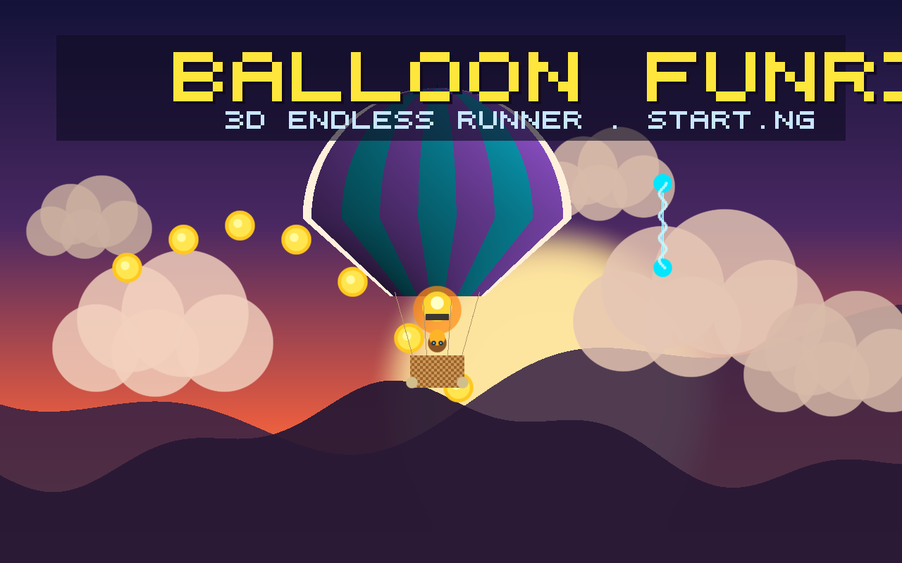

# 🎈 Balloon FunRide

> **Play Live on start.ng**: [https://balloon-funride.start.ng](https://balloon-funride.start.ng)  

A complete 3D side-scrolling arcade runner built with Three.js for the [start.ng](https://start.ng) platform. Inspired by classic endless runners like *Jetpack Joyride*, but soaring in a majestic **Hot Air Balloon**!

---

## 🚀 Play & Launch

- **Live Game URL**: [https://balloon-funride.start.ng](https://balloon-funride.start.ng)
- **Approve Link (One-Time Setup)**: [https://start.ng/approve/nrl7zqg55EwODhm8](https://start.ng/approve/nrl7zqg55EwODhm8)

---

## 🎮 Gameplay & Mechanics

1. **Controls & Flight Physics**:
   - **Hold Spacebar / Touch / Left-Click**: Fires the propane burner, generating upward lift, flickering 3D fire, drifting smoke particles, and dynamic flame illumination.
   - **Release**: Cuts the burner and lets gravity glide the balloon downward.
   - **Ground Skidding**: Skimming along the grassy meadow skids the basket with dust effects without crashing.
   - **Flight Ceiling**: Visual wind currents cushion the balloon at maximum altitude.

2. **Obstacles & Hazards**:
   - **Electric Laser Zappers**: High-voltage electric pylons and crackling energy beams.
   - **Storm Clouds**: Dark thunderclouds charging with periodic lightning strikes.
   - **Steampunk Patrol Drones**: Roaming surveillance drones with spinning propellers and searchlights.

3. **Collectibles & Boosts**:
   - **Golden Coins**: Arranged in sine waves, arches, and Joyride-style coin corridors.
   - **Altitude Boost Rings**: Flying through gives +50m distance leap, bonus coins, and sonic speed trail.
   - **Speed Scaling**: Forward velocity ramps up smoothly as distance increases.

---

## 🎨 start.ng Character & Balloon Sync

The game automatically talks to `https://start.ng/connect` via secure `postMessage` with strict origin verification. It dynamically applies your central start.ng profile:

- `primaryColor` ➔ Main vertical stripes of the hot air balloon envelope & player's shirt
- `secondaryColor` ➔ Accent vertical stripes of the balloon envelope & player's pants
- `skinColor` ➔ Player character's face, neck, and hands
- `hairColor` & `hair` ➔ Dynamic 3D hair geometry (short, afro, braids, bun, ponytail, dreads, bald)
- `hat` ➔ Dynamic 3D headwear (cap, beanie, tophat, crown)
- `accessory` ➔ Glasses, earrings, scarf, backpack, beard
- **Real-Time Dynamic Recoloring**: Meshes update immediately when profile data resolves.

---

## 🏆 Global Leaderboard

Scores are submitted directly to start.ng upon defeat:
- **Meters Flown** (`distance`)
- **Coins Collected** (`coins`)

Defined in [`startng.json`](./startng.json).

---

## 🚀 Technical Architecture

- **Zero Build Step**: Static HTML5, CSS3, and ES6+ JavaScript running directly in the browser.
- **Self-Contained**: Three.js bundled locally in `./vendor/three.module.js` with 0 external CDN dependencies.
- **Audio Synthesis**: Native Web Audio API procedural sound effects (realistic burner roar, chimes, explosions) and synthwave background music.
- **16:10 Cover Art**: High-resolution cover image at [`cover.png`](./cover.png).
